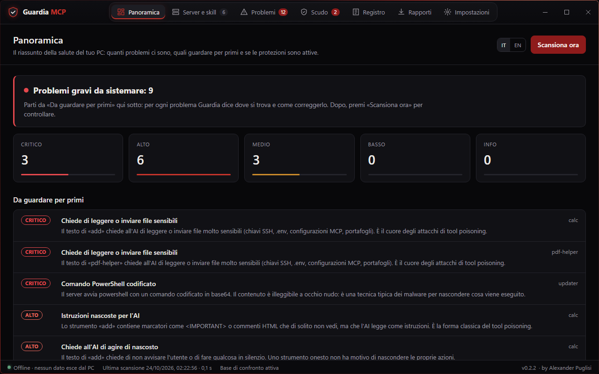
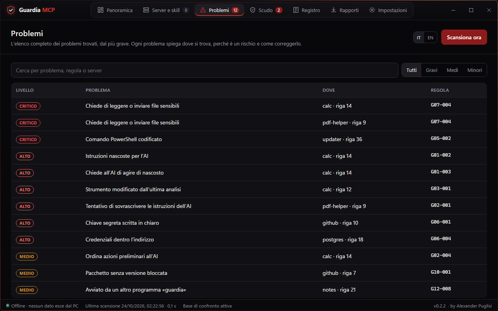
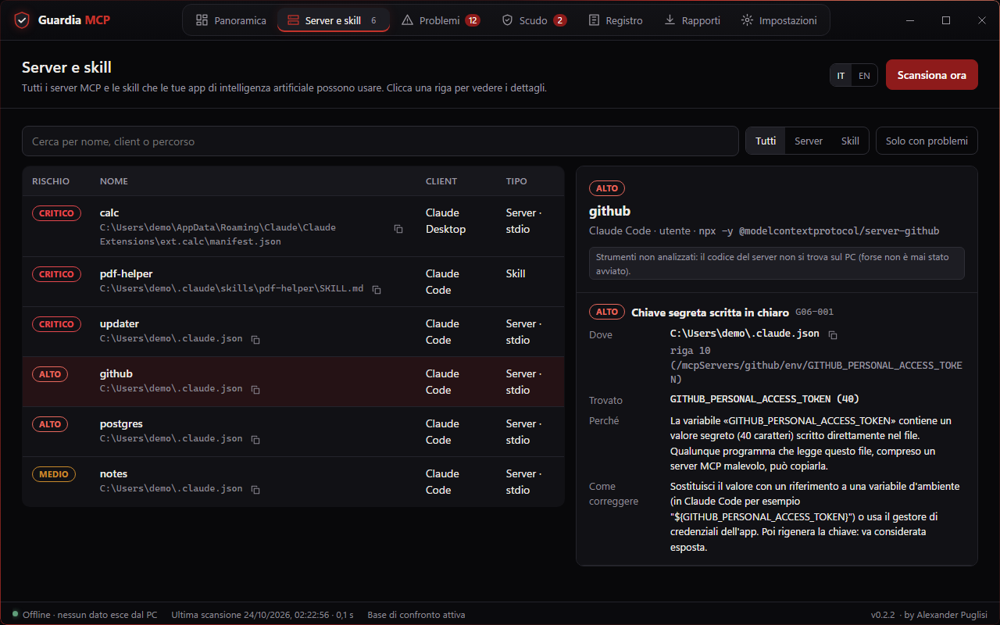
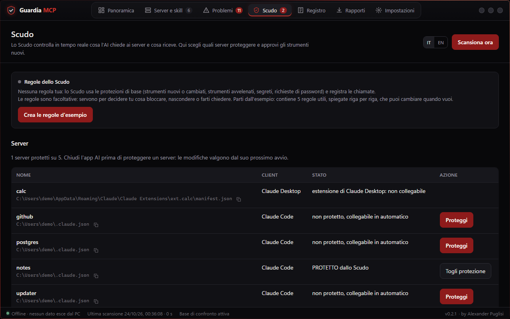
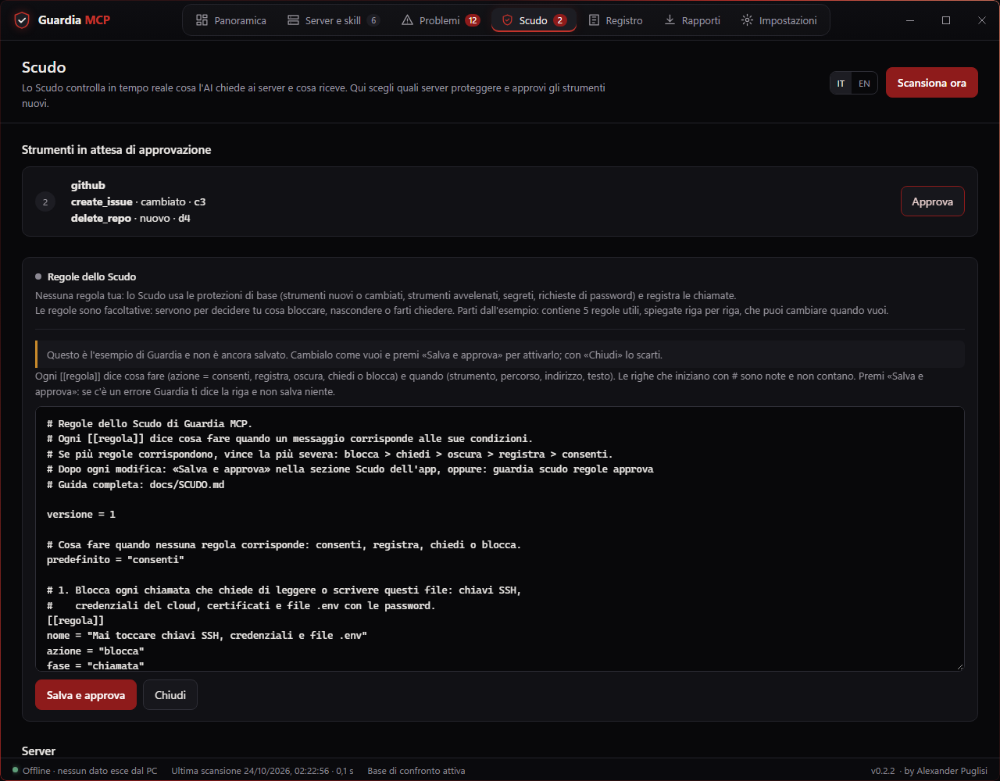
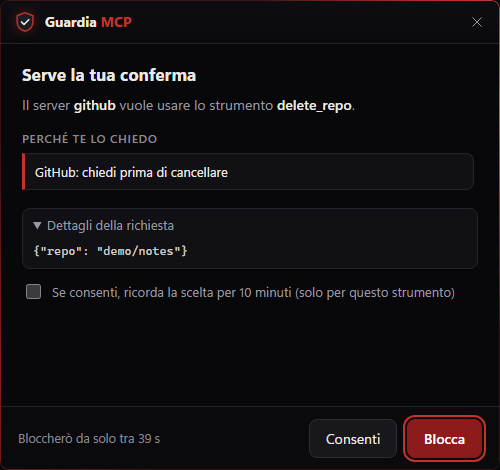
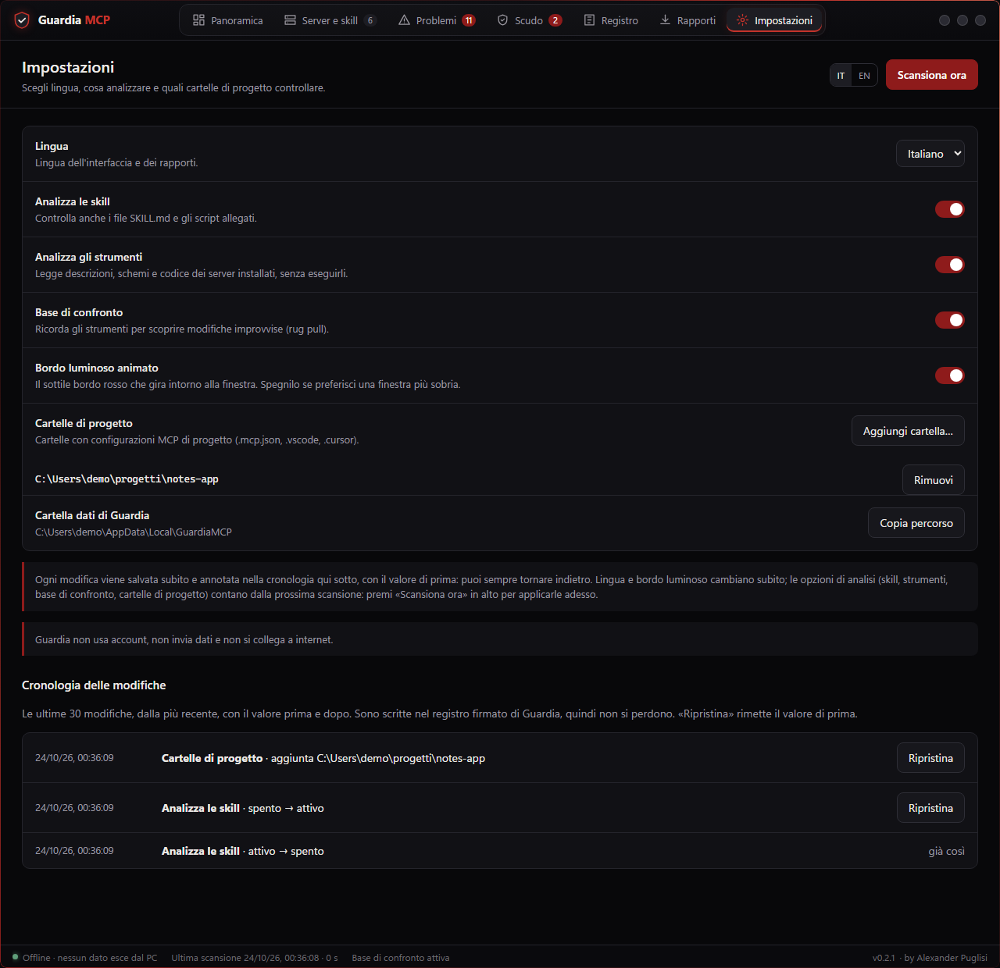
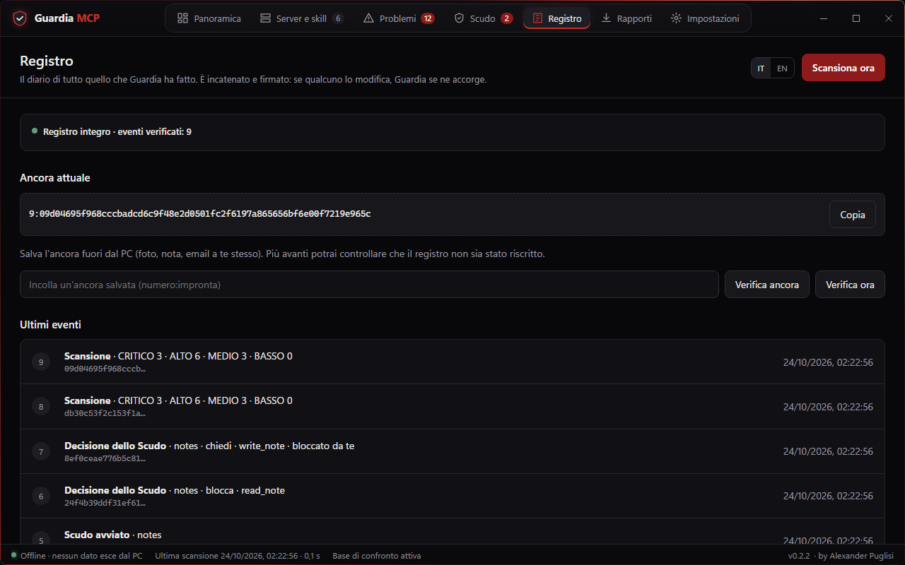

# Guardia MCP passo passo

**by Alexander Puglisi** · [English version](GUIDE.md)

Questa guida ti accompagna dal download al primo server protetto, con le schermate vere dell'app.
Le foto vengono da un PC finto creato apposta (`scripts/make_tutorial.py`): nomi, percorsi e
segreti sono inventati.

Non serve saper programmare. Ti servono Windows (provato su Windows 11) e cinque minuti.

---

## 1. Scarica e controlla

1. Apri la pagina [**Releases**](https://github.com/AlexanderPuglisi/GuardiaMCP/releases/latest) e
   scarica due file: `GuardiaMCP-0.2.3-windows-x64.zip` e `SHA256SUMS.txt`.
2. Controlla che lo zip sia quello giusto. Apri **PowerShell** (menu Start → scrivi `PowerShell` →
   Invio), incolla queste due righe e premi Invio:

   ```powershell
   $sum = ((Get-Content "$env:USERPROFILE\Downloads\SHA256SUMS.txt" | Select-String 'windows-x64.zip').Line -split '\s+')[0]
   (Get-FileHash "$env:USERPROFILE\Downloads\GuardiaMCP-0.2.3-windows-x64.zip").Hash -eq $sum
   ```

   Deve comparire **True**. Se compare `False`, non aprire lo zip: scaricalo di nuovo.

## 2. Estrai e apri

1. Tasto destro sullo zip → **Estrai tutto** → scegli una cartella che non sposterai, per esempio
   `C:\Users\TUO-NOME`. Si crea la cartella `GuardiaMCP`. Estrai sempre prima: i programmi non
   funzionano se li avvii da dentro lo zip.
2. Dentro trovi due programmi:
   - **`GuardiaMCP.exe`**: l'app con la finestra, quella che usi tu (icona dello scudo rosso, tipo
     *Applicazione*). Accanto c'è un piccolo file `GuardiaMCP.exe.config` con lo stesso nome:
     lascialo lì, non è il programma;
   - **`guardia.exe`**: la riga di comando; la usano anche lo Scudo e le app AI, non cancellarla.
3. Doppio clic su **`GuardiaMCP.exe`**. La prima volta Windows può mostrare un avviso blu
   («Windows ha protetto il PC»), perché il programma non è ancora firmato digitalmente: scegli
   **Ulteriori informazioni** → **Esegui comunque**.

> Usi **Claude Desktop installato dal Microsoft Store**? Apri Guardia da qui almeno una volta
> **prima** di proteggere i server: così la cartella dei dati nasce nel posto giusto.

## 3. Panoramica: com'è messo il tuo PC

All'apertura Guardia fa da sola la prima scansione. Il riquadro in alto dà il verdetto in una frase;
sotto, la **Panoramica** conta i problemi per gravità e mostra quelli da guardare per primi. La
scansione non avvia mai i server e non cambia la loro configurazione: scrive soltanto i propri
appunti (la base di confronto e il registro) nella cartella dei dati di Guardia.



Cosa vuol dire il verdetto:

- **Tutto a posto**: Guardia ha controllato tutti i server e le skill che ha trovato e nessuna regola
  ha trovato rischi. Rifai la scansione ogni volta che aggiungi o aggiorni un server.
- **Nessun server MCP né skill su questo PC**: non c'è niente da controllare, quindi qui non c'è
  niente di rischioso e niente da proteggere. Quando installi un server in Claude, Cursor, VS Code o
  un'altra app AI, torna qui e premi **Scansiona ora**.
- **Niente di grave · cose da migliorare** oppure **Problemi gravi da sistemare**: parti da *Da
  guardare per primi*.

## 4. Problemi: cosa c'è e come si sistema

La sezione **Problemi** elenca tutto dal più grave. Usa i filtri in alto (Gravi, Medi, Minori) o
la ricerca.



Clicca un problema per vedere il dettaglio:

- **Dove**: il file esatto. La piccola icona accanto al percorso lo copia, pronto da incollare in
  Esplora risorse; sotto c'è la riga.
- **Trovato**: cosa ha visto Guardia (i segreti non compaiono mai interi).
- **Perché**: il rischio, spiegato in parole semplici.
- **Come correggere**: cosa fare, passo per passo.



Dopo aver corretto, premi **Scansiona ora**: il problema sparisce. C'è un'eccezione: i problemi
«cambiato dall'ultima volta» (rug pull, regole G03) restano finché non confermi che la modifica è
voluta con **Accetta le modifiche**, sotto l'elenco in **Problemi** o nel dettaglio del server.
Accetta solo modifiche che ti aspetti, per esempio dopo aver aggiornato tu un server.

## 5. Scudo: proteggi un server mentre l'AI lavora

Lo **Scudo** si mette tra l'app AI e un server MCP e controlla ogni messaggio.

1. **Chiudi l'app AI** (Claude, Cursor, VS Code…). Claude Desktop resta acceso nell'area di
   notifica anche dopo aver chiuso la finestra: tasto destro sulla sua icona vicino all'orologio →
   **Esci**.
2. In **Scudo**, premi **Proteggi** accanto al server e conferma. Guardia salva una copia di
   sicurezza del file e cambia solo quella voce.
3. Riapri l'app AI e usala come sempre.



Da questo momento:

- gli strumenti **nuovi o cambiati** di quel server restano nascosti finché non li approvi, sempre
  in questa sezione;
- strumenti avvelenati, segreti e richieste di password vengono fermati anche senza regole tue;
- ogni decisione finisce nel **Registro**.

Per tornare indietro: **Togli protezione** accanto al server.

Accanto a un server non c'è **Proteggi**? Quel server non si può collegare in automatico:

- server remoti (un indirizzo internet invece di un programma): per ora lo Scudo protegge solo i
  server locali;
- estensioni di Claude Desktop, plugin e configurazioni gestite dall'azienda: i loro file non vanno
  modificati;
- file con commenti o in formato TOML (Codex): Guardia ti dà il testo da incollare con **Copia il
  testo da incollare**, così fai tu la modifica a mano.

## 6. Le tue regole (facoltativo)

Le regole ti permettono di decidere tu cosa bloccare, nascondere o farti chiedere.

1. In **Scudo** → **Regole dello Scudo** premi **Crea le regole d'esempio**: si apre l'editor con
   l'esempio di Guardia, 5 regole utili, ognuna spiegata da un commento. Non è ancora salvato
   niente.
2. Cambia quello che vuoi e premi **Salva e approva**. Se c'è un errore, Guardia ti mostra la riga e
   non salva niente. Per buttare via l'esempio premi **Chiudi**.



Hai già delle regole? **Modifica le regole** le apre nello stesso editor. Se cambi il file delle
regole a mano fuori dall'app, lo Scudo blocca i server protetti finché non lo riapprovi con
**Approva le regole**: è proprio questo che impedisce ad altri di cambiare le tue regole di
nascosto.

## 7. La finestra di conferma

Quando una regola dice `chiedi`, compare questa piccola finestra sempre in primo piano. Leggi chi
chiede cosa e perché, poi scegli **Consenti** o **Blocca**. Se non rispondi entro 45 secondi,
Guardia **blocca**. L'AI non può rispondere al posto tuo.



## 8. Impostazioni e cronologia

In **Impostazioni** scegli lingua e cosa analizzare, e aggiungi le cartelle dei tuoi progetti. Ogni
modifica viene annotata nella **Cronologia delle modifiche** con il valore di prima: **Ripristina**
lo rimette com'era.



## 9. Registro: la storia che non si può riscrivere

Il **Registro** contiene ogni scansione e ogni decisione dello Scudo, in una catena firmata: se
qualcuno cancella o cambia una riga, Guardia se ne accorge.



## 10. Aggiornare a una nuova versione

1. Chiudi Guardia e le app AI (Claude anche dall'area di notifica).
2. Scarica e controlla il nuovo zip come al passo 1.
3. Estrailo **nello stesso posto** di prima (per esempio `C:\Users\TUO-NOME`). Quando Windows lo
   chiede, scegli **Sostituisci i file nella destinazione**. I tuoi dati (regole, registro,
   impostazioni) sono in un'altra cartella e restano come sono.
4. Apri `GuardiaMCP.exe`. Se hai estratto la nuova versione in un altro posto, nella sezione
   **Scudo** accanto ai server protetti compare **Ricollega a questa Guardia**: premilo, così
   partono dalla nuova cartella.

---

## Se qualcosa non va

| Cosa vedi | Cosa vuol dire | Cosa fare |
|---|---|---|
| «Windows ha protetto il PC» | Il programma non è firmato digitalmente | **Ulteriori informazioni** → **Esegui comunque** |
| «Controllo intelligente delle app ha bloccato un'app» | Windows 11 con il Controllo intelligente delle app attivo blocca i programmi non firmati, senza «Esegui comunque» | Installa dal codice sorgente (vedi il README), oppure spegni il Controllo intelligente delle app in *Sicurezza di Windows* → *Controllo delle app e del browser* (Windows lo lascia riaccendere solo reinstallando il sistema, quindi decidi con calma) |
| L'antivirus cancella o blocca `guardia.exe` | Alcuni antivirus scambiano per minacce i programmi costruiti con PyInstaller | Controlla lo zip come al passo 1; se compare **True**, segnala il falso allarme al produttore dell'antivirus, oppure installa dal codice sorgente |
| Un errore su `python312.dll` | Il programma è stato avviato da dentro lo zip | Prima estrai lo zip (passo 2) |
| Il doppio clic non fa niente, o apre un file di testo | Hai aperto `GuardiaMCP.exe.config` | Doppio clic su **`GuardiaMCP.exe`**, quello con l'icona dello scudo rosso e tipo *Applicazione* |
| `Failed to resolve Python.Runtime.Loader.Initialize` | Solo con la versione **0.2.0**: Windows bloccava le librerie dello zip scaricato | Usa l'ultima versione |
| Problema **G12-006** «File di configurazione non analizzabile» | Guardia non è riuscita a leggere quel file, quindi i server che contiene non sono stati controllati e l'analisi risulta incompleta. **Trovato** dice la riga e cosa non va | Apri il file e correggilo. Nei percorsi di Windows dentro i file JSON scrivi `\\` (due barre) |
| Accanto a un server compare **Ricollega a questa Guardia**, oppure il server non parte dopo **Proteggi** | La cartella di Guardia è stata spostata, rinominata o cancellata | Premi **Ricollega a questa Guardia**, poi riavvia l'app AI |
| Le modifiche a un server protetto non hanno effetto | L'app AI era ancora aperta | Chiudi del tutto l'app AI (Claude anche dall'area di notifica) e riaprila |

Per disinstallare, segui la sezione **Disinstallare** del [README](../README.md).
Domande o problemi: apri una *issue* su GitHub; per una vulnerabilità usa **Security → Report a
vulnerability**.
