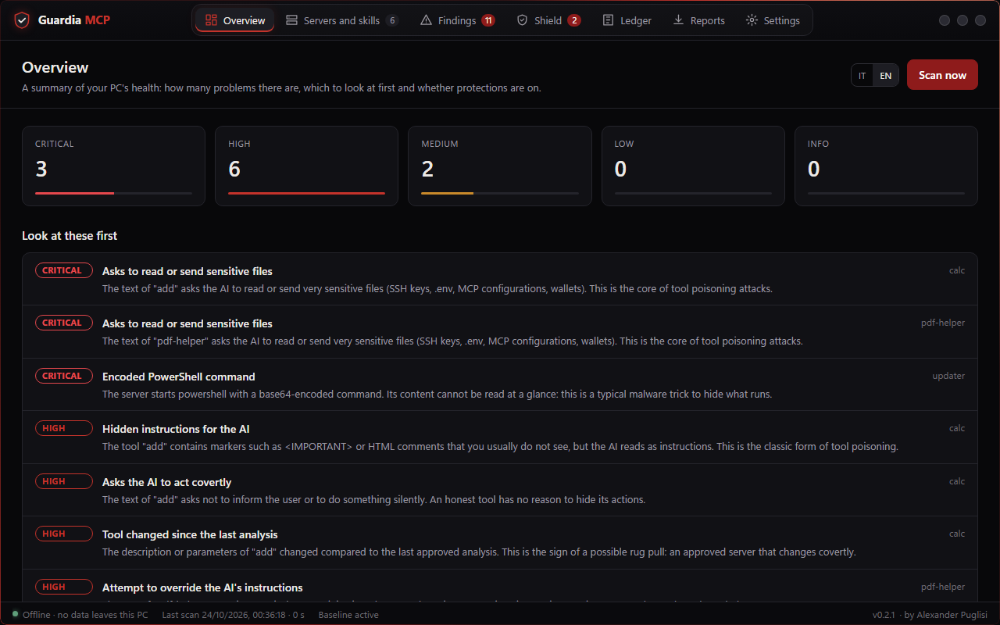
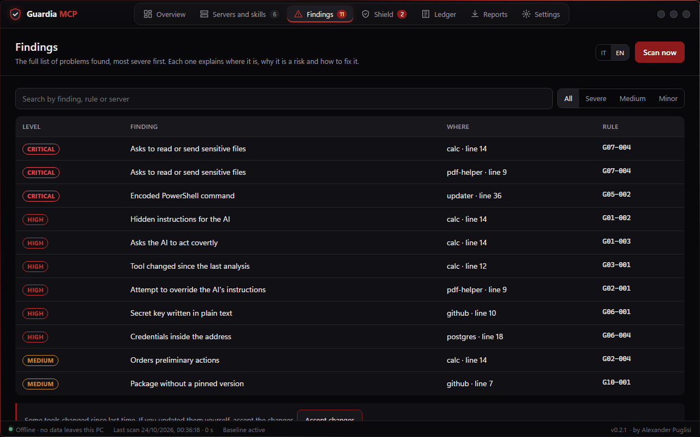
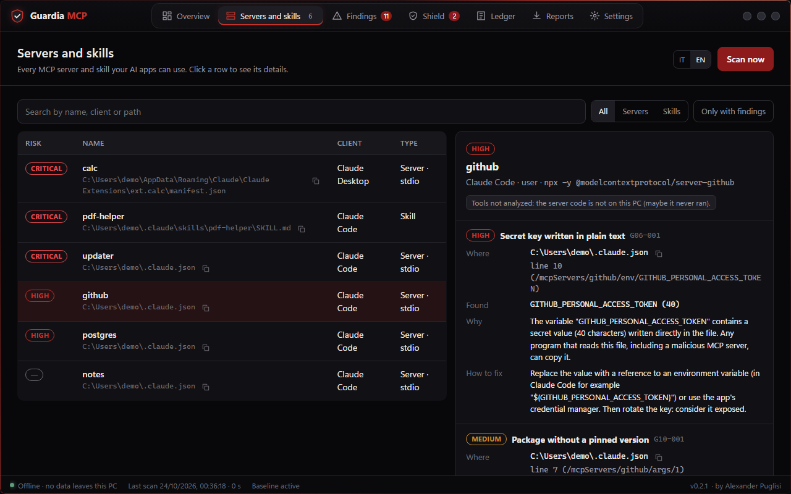
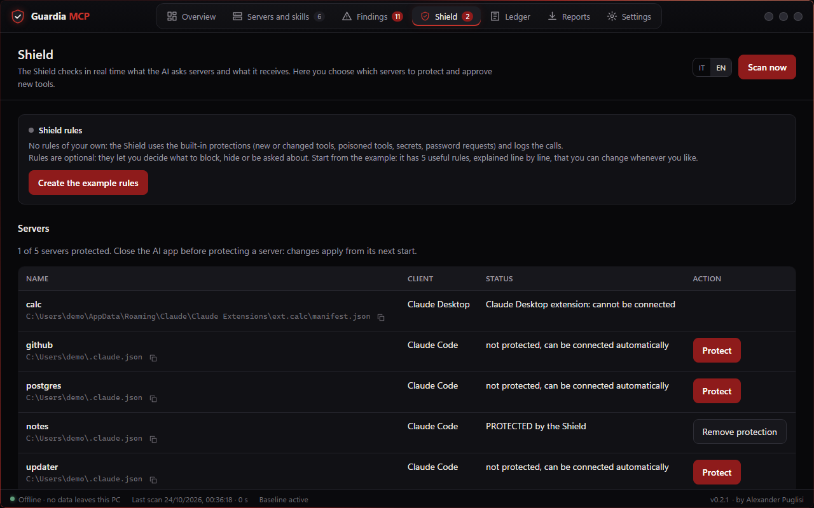
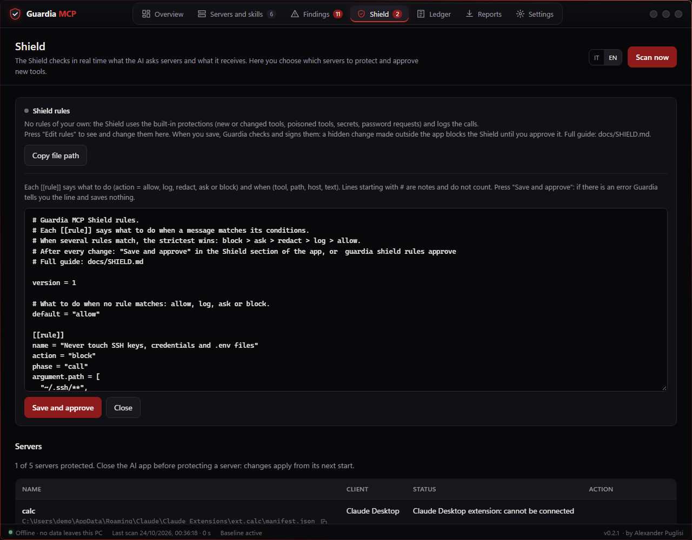
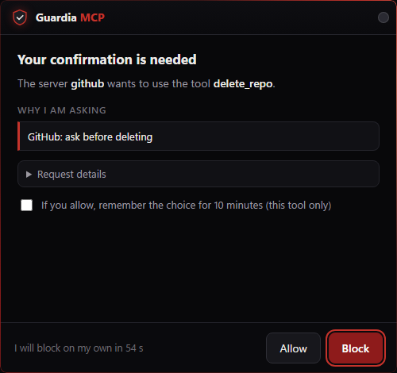
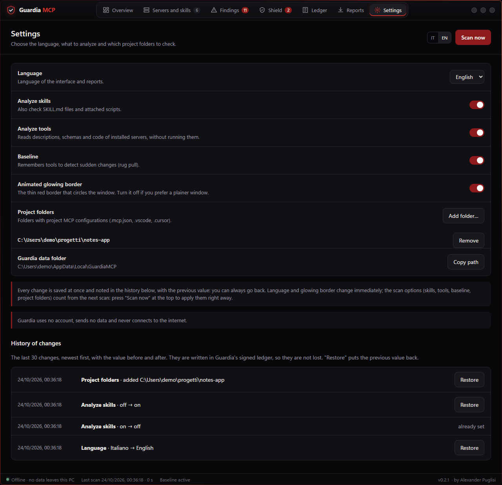
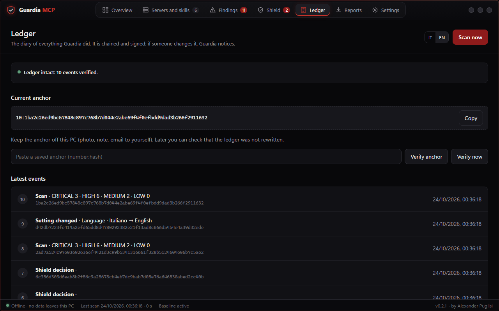

# Guardia MCP step by step

**by Alexander Puglisi** · [Versione italiana](GUIDA.md)

This guide takes you from the download to your first protected server, with real screenshots of the
app. The pictures come from a fake PC built for the purpose (`scripts/make_tutorial.py`): names,
paths and secrets are made up.

No programming needed. You need Windows 10 or 11 and five minutes.

---

## 1. Download and check

1. Open the [**Releases**](https://github.com/AlexanderPuglisi/guardia-mcp/releases/latest) page and
   download `GuardiaMCP-0.2.1-windows-x64.zip`.
2. Check that the file is the right one. Open **PowerShell** and type:

   ```powershell
   Get-FileHash "$env:USERPROFILE\Downloads\GuardiaMCP-0.2.1-windows-x64.zip"
   ```

   The value must match the one in `SHA256SUMS.txt` on the same page. If it differs, do not open the
   zip.

## 2. Extract and open

1. Right-click the zip → **Extract All** → pick a folder you will not move, for example
   `C:\Users\YOUR-NAME`. A `GuardiaMCP` folder is created.
2. Inside there are two programs:
   - **`GuardiaMCP.exe`**: the app with the window, the one you use;
   - **`guardia.exe`**: the command line; the Shield and the AI apps use it too, do not delete it.
3. Double-click **`GuardiaMCP.exe`**. The first time Windows may show a blue warning ("Windows
   protected your PC") because the program is not code-signed yet: choose **More info** → **Run
   anyway**.

> Using **Claude Desktop from the Microsoft Store**? Open Guardia from here at least once **before**
> protecting servers, so its data folder is created in the right place.

## 3. Overview: how your PC is doing

When it opens, Guardia runs the first scan by itself. The **Overview** counts problems by severity
and shows the ones to look at first. The scan only reads: it changes nothing on your PC.



## 4. Findings: what is there and how to fix it

**Findings** lists everything, most serious first. Use the filters at the top (Severe, Medium,
Minor) or the search box.



Click a finding to see the details:

- **Where**: the exact file. The small icon next to the path copies it, ready to paste into File
  Explorer; the line is underneath.
- **Found**: what Guardia saw (secrets are never shown in full).
- **Why**: the risk, in plain words.
- **How to fix**: what to do, step by step.



After fixing, press **Scan now**: the finding goes away.

## 5. Shield: protect a server while the AI works

The **Shield** sits between the AI app and an MCP server and checks every message.

1. **Close the AI app** (Claude, Cursor, VS Code…).
2. In **Shield**, press **Protect** next to the server and confirm. Guardia backs up the file and
   changes only that entry.
3. Reopen the AI app and use it as usual.



From then on:

- **new or changed** tools of that server stay hidden until you approve them, in the same section;
- poisoned tools, secrets and password requests are stopped even without rules of your own;
- every decision goes into the **Ledger**.

To undo: **Remove protection** next to the server.

## 6. Your own rules (optional)

Rules let you decide what to block, hide or be asked about.

1. In **Shield** → **Shield rules** press **Create the example rules**.
2. Press **Edit rules**: the example has 5 useful rules, explained line by line.
3. Change what you want and press **Save and approve**. If something is wrong, Guardia shows the line
   and saves nothing.



Do it with the AI app closed: until the rules are approved, protected servers are blocked.

## 7. The confirmation window

When a rule says `ask`, this small always-on-top window appears. Read who asks for what and why,
then choose **Allow** or **Block**. No answer within 60 seconds means **block**. The AI cannot answer
for you.



## 8. Settings and history

In **Settings** you choose the language and what to scan, and add your project folders. Every change
is noted in the **History of changes** with the previous value: **Restore** puts it back.



## 9. Ledger: a history that cannot be rewritten

The **Ledger** holds every scan and every Shield decision in a signed chain: if someone deletes or
changes a line, Guardia notices.



---

## If something goes wrong

| What you see | What it means | What to do |
|---|---|---|
| "Windows protected your PC" | The program is not code-signed | **More info** → **Run anyway** |
| `Failed to resolve Python.Runtime.Loader.Initialize` | Only with version **0.2.0**: Windows blocked the libraries of the downloaded zip | Download **0.2.1**. Otherwise: right-click the zip → **Properties** → **Unblock**, then extract again |
| Finding **G12-006** "Configuration file could not be analyzed" | Guardia could not read that file, so the servers in it were not checked. The detail gives the line of the error | Open the file and fix its format. Since 0.2.1 an **empty** file is no longer reported |
| A server does not start after **Protect** | Guardia's folder was moved or deleted | Put the folder back, or **Remove protection** and protect again |

To uninstall, follow the **Uninstall** section of the [README](../README.md).
Questions or problems: open an *issue* on GitHub; for a vulnerability use **Security → Report a
vulnerability**.
